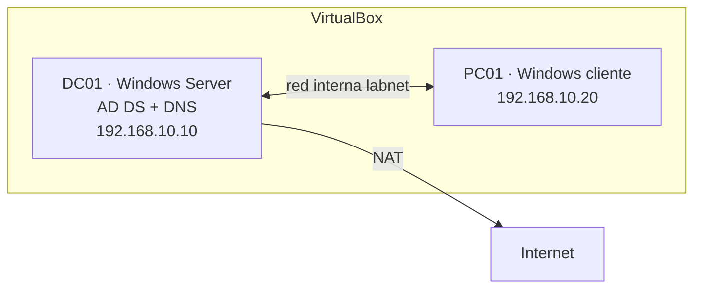

# Active Directory IAM Lab: gestión de identidades y accesos con Windows Server

Laboratorio local con un dominio de Windows Server para practicar la gestión de identidades y accesos (IAM): usuarios, grupos, permisos por rol (RBAC) y políticas de grupo. Está documentado paso a paso para que cualquiera pueda repetirlo.

## Índice
- [Objetivo](#objetivo)
- [Estado del proyecto](#estado-del-proyecto)
- [Arquitectura](#arquitectura)
- [Requisitos](#requisitos)
- [Guía paso a paso](#guía-paso-a-paso)
- [Resultados](#resultados)
- [Lo que aprendí](#lo-que-aprendí)
- [Limitaciones](#limitaciones)
- [Próximos pasos](#próximos-pasos)
- [Nota sobre el uso de IA](#nota-sobre-el-uso-de-ia)
- [Autor](#autor)

## Objetivo
Entender cómo funciona la gestión de identidades en una empresa: crear identidades, agruparlas, asignar permisos a los grupos (y no a las personas) y comprobar que se cumple el principio de **privilegios mínimos**.

## Estado del proyecto
| Fase | Contenido | Estado |
|---|---|---|
| 1 | Preparación y máquinas virtuales | ✅ |
| 2 | Instalación de Windows Server | ✅ |
| 3 | Nombre, IP y creación del dominio | ✅ |
| 4 | OUs, grupos y usuarios | ✅ |
| 5 | Cliente unido al dominio | ⏳ |
| 6 | Permisos por rol (RBAC) | ⏳ |
| 7 | Políticas de grupo (GPO) | ⏳ |

## Arquitectura

| Elemento | Valor |
|---|---|
| Dominio | `lab.local` |
| Controlador de dominio | DC01 |
| Cliente | PC01 |
| Red interna | `labnet` (192.168.10.0/24) |

## Requisitos
- 8 GB de RAM como mínimo (16 GB recomendado) y unos 80 GB de disco libres.
- VirtualBox.
- ISOs de evaluación de Windows Server y de un Windows cliente, desde el Microsoft Evaluation Center.

## Guía paso a paso
1. [Preparación y máquinas virtuales](docs/01-preparacion.md)
2. [Instalación de Windows Server](docs/02-windows-server.md)
3. [Nombre, IP y dominio](docs/03-nombre-ip-dominio.md)
4. [OUs, grupos y usuarios](docs/04-ou-grupos-usuarios.md)
5. Cliente y unión al dominio *(pendiente)*
6. Permisos por rol *(pendiente)*
7. Políticas de grupo *(pendiente)*

## Resultados
Las pruebas de acceso se registran en [pruebas.md](pruebas.md).

## Lo que aprendí
*(Se completa al terminar el laboratorio, con mis propias palabras.)*

## Limitaciones
- Es un laboratorio con datos y usuarios ficticios, no un entorno de producción.
- Usa versiones de evaluación de Windows (180 días).
- Las contraseñas y configuraciones son solo para pruebas.

## Próximos pasos
- Mini proyecto IAM: ciclo de vida de un usuario (ingreso, cambio de rol y salida) con PowerShell.
- Práctica equivalente en Microsoft Entra ID.
- Preparación del examen SC-900.

## Nota sobre el uso de IA
Usé herramientas de inteligencia artificial como apoyo para aprender, resolver dudas y documentar. Ejecuté y verifiqué cada paso en mi propio laboratorio.

## Autor
**Michael Lopez Arenas** · Estudiante de Ingeniería de Sistemas · [LinkedIn](https://www.linkedin.com/in/michael-felipe-lopez/)
