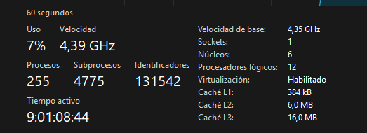
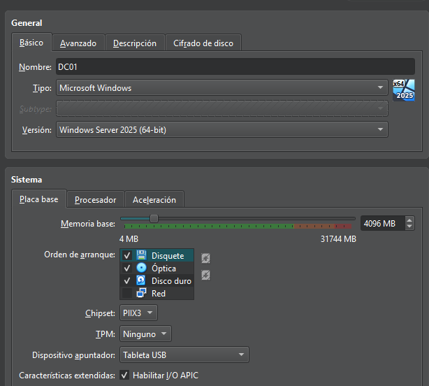
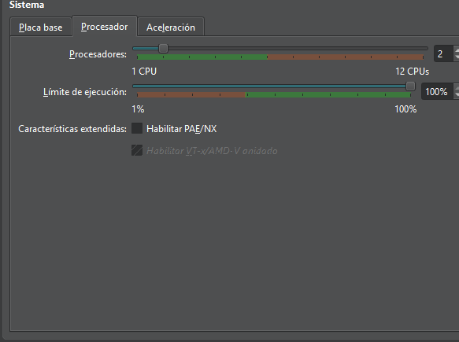
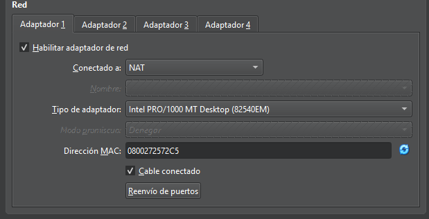
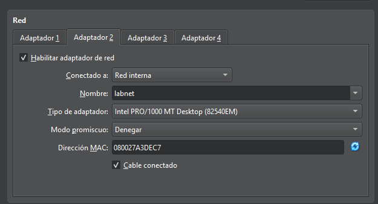

# 01 · Preparación y máquinas virtuales

## Objetivo
Dejar listo el equipo anfitrión y crear la máquina virtual del servidor (DC01).

## 1. Verificar la virtualización
Administrador de tareas → Rendimiento → CPU. Debe indicar **Virtualización: Habilitado**. Si no, se activa en la BIOS/UEFI.

## 2. Instalar VirtualBox
Descargado desde virtualbox.org con las opciones por defecto.

## 3. Descargar la ISO de Windows Server
Versión de evaluación (180 días) desde el Microsoft Evaluation Center.
Versión usada: **Windows Server 2025 Standard Evaluation** (compilación 26100).

## 4. Crear la VM DC01
| Campo | Valor |
|---|---|
| Nombre | DC01 |
| Tipo / Versión | Microsoft Windows / Windows Server 2025 (64-bit) |
| Instalación desatendida | Omitida (instalación manual) |
| Memoria | 4096 MB |
| Procesadores | 2 |
| Disco | 40 GB |

## 5. Configurar la red
| Adaptador | Modo | Para qué |
|---|---|---|
| 1 | NAT | Salida a internet |
| 2 | Red interna `labnet` | Comunicación con el cliente |

*Adaptador 1 en modo NAT (salida a internet).*

*Adaptador 2 conectado a la red interna `labnet`.*

## Verificación
La VM aparece en VirtualBox con los dos adaptadores configurados.
