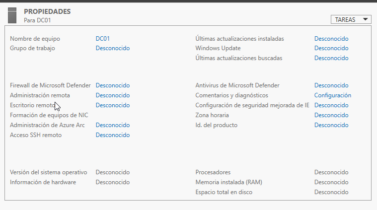
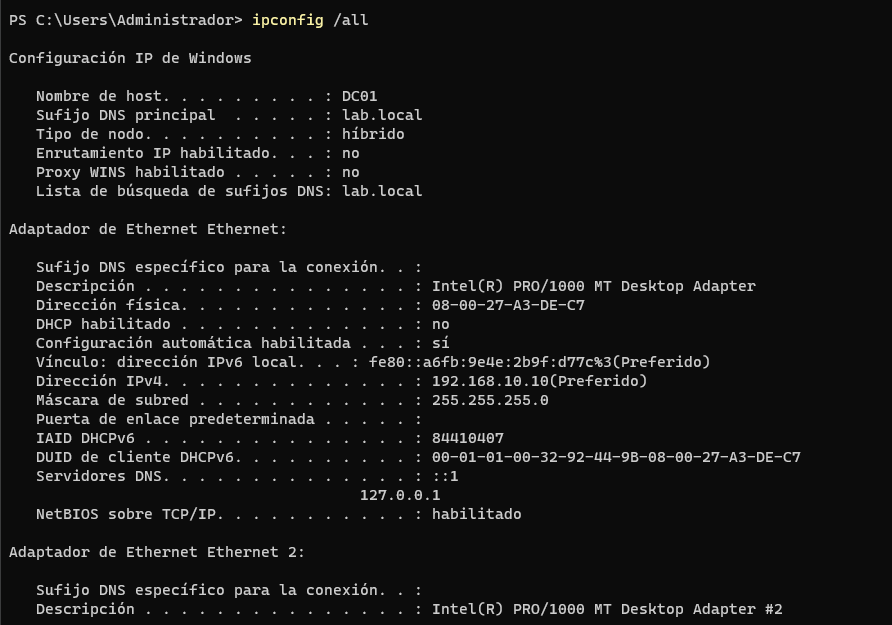
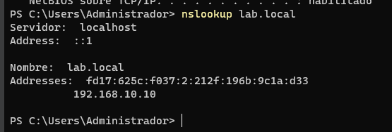

# 03 · Nombre, IP y creación del dominio

## Objetivo
Dejar DC01 con nombre e IP fija, instalar Active Directory Domain Services (AD DS) y crear el dominio `lab.local`.

## 1. Nombre del servidor
Administrador del servidor → Servidor local → Cambiar el nombre del equipo → `DC01` → reinicio.



## 2. IP fija en la red interna
El adaptador de la red `labnet` se identifica porque inicialmente tiene una IP `169.254.x.x`. Se configuró de forma manual:

| Campo | Valor |
|---|---|
| IP | 192.168.10.10 |
| Máscara | 255.255.255.0 |
| DNS preferido | 127.0.0.1 (el propio servidor) |
| Puerta de enlace | vacía |

El controlador de dominio necesita una IP fija y usarse a sí mismo como DNS, porque los equipos del dominio localizan a Active Directory a través de DNS.



*`ipconfig /all`: el adaptador de `labnet` tiene la IP fija y usa `::1` y `127.0.0.1` como servidores DNS.*

## 3. Instalar el rol AD DS
Administrar → Agregar roles y características → Servicios de dominio de Active Directory → Instalar.

## 4. Promover el servidor a controlador de dominio
1. Promover este servidor a controlador de dominio.
2. Agregar un nuevo bosque, con dominio raíz `lab.local`.
3. Niveles funcionales por defecto y contraseña de DSRM (solo laboratorio).
4. Nombre NetBIOS `LAB` y rutas por defecto.
5. Instalar; el servidor se reinicia solo.
6. Inicio de sesión como `LAB\Administrator`.

## Verificación
"Usuarios y equipos de Active Directory" muestra el dominio `lab.local` con sus contenedores predeterminados (Builtin, Computers, Domain Controllers, Users y otros).


## Problemas encontrados

### El DNS devolvía también la IP del adaptador NAT
**Síntoma:** `nslookup lab.local` respondía con `192.168.10.10` y además con `10.0.2.15`, que es la IP del adaptador NAT. El cliente solo estará en `labnet`, así que no podría alcanzar esa dirección y la unión al dominio fallaría o sería intermitente.

**Causa:** DC01 tiene dos adaptadores y registró en su zona DNS las direcciones de ambos. Es un caso típico de servidores con varias tarjetas de red.

**Solución:**
```powershell
$nat = (Get-NetIPAddress -IPAddress 10.0.2.15).InterfaceAlias
Set-DnsClient -InterfaceAlias $nat -RegisterThisConnectionsAddress $false
Get-DnsServerResourceRecord -ZoneName "lab.local" -RRType A | Where-Object { $_.RecordData.IPv4Address -eq "10.0.2.15" } | Remove-DnsServerResourceRecord -ZoneName "lab.local" -Force
Restart-Service netlogon
ipconfig /registerdns
```
Primero se impide que el adaptador NAT se registre en el DNS, luego se borra el registro sobrante y se vuelve a registrar el servidor.

**Resultado:** `nslookup lab.local` devuelve `192.168.10.10`.



*Además de la IPv4, aparece una dirección IPv6 que empieza por `fd17`, que corresponde al adaptador NAT de VirtualBox. El laboratorio usa solo IPv4, así que se deja como está y se revisaría únicamente si el cliente tuviera problemas al unirse al dominio.*

**Lección:** en un controlador de dominio, conviene que el DNS resuelva solo las direcciones por las que los clientes pueden llegar.
