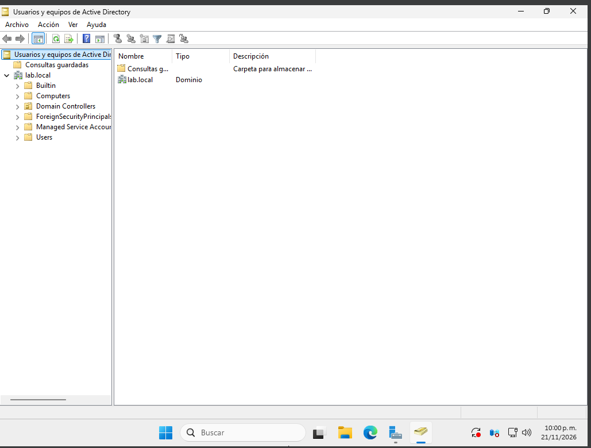

# 03 · Nombre, IP y creación del dominio

## Objetivo
Dejar DC01 con nombre e IP fija, instalar Active Directory Domain Services (AD DS) y crear el dominio `lab.local`.

## 1. Nombre del servidor
Administrador del servidor → Servidor local → Cambiar el nombre del equipo → `DC01` → reinicio.

## 2. IP fija en la red interna
El adaptador de la red `labnet` se identifica porque inicialmente tiene una IP `169.254.x.x`. Se configuró de forma manual:

| Campo | Valor |
|---|---|
| IP | 192.168.10.10 |
| Máscara | 255.255.255.0 |
| DNS preferido | 127.0.0.1 (el propio servidor) |
| Puerta de enlace | vacía |

El controlador de dominio necesita una IP fija y usarse a sí mismo como DNS, porque los equipos del dominio localizan a Active Directory a través de DNS.

## 3. Instalar el rol AD DS
Administrar → Agregar roles y características → Servicios de dominio de Active Directory → Instalar.

## 4. Promover el servidor a controlador de dominio
1. Promover este servidor a controlador de dominio.
2. Agregar un nuevo bosque, con dominio raíz `lab.local`.
3. Niveles funcionales por defecto y contraseña de DSRM (solo laboratorio).
4. Nombre NetBIOS `LAB` y rutas por defecto.
5. Instalar; el servidor se reinicia solo.
6. Inicio de sesión como `LAB\Administrator`.

## Verificación
"Usuarios y equipos de Active Directory" muestra el dominio `lab.local` con sus contenedores predeterminados (Builtin, Computers, Domain Controllers, Users y otros).

## Problemas encontrados
*(Anotar aquí cualquier error y cómo se resolvió.)*
