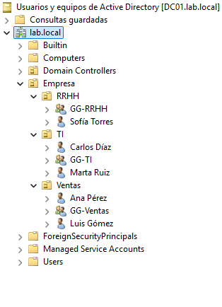
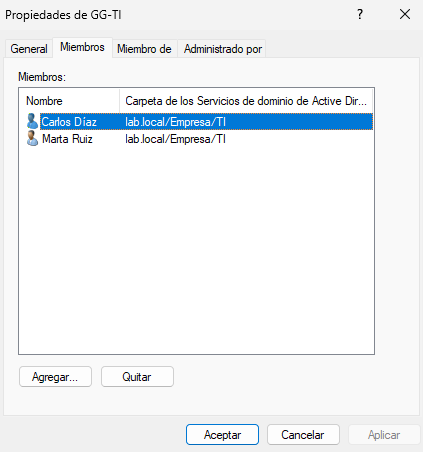

# 04 · Unidades organizativas, grupos y usuarios

## Objetivo
Modelar una empresa ficticia en Active Directory: ordenar a las personas por área y agruparlas, para asignar permisos a los **grupos** y no a cada usuario (base del control de acceso por roles, RBAC).

## Diseño
Una OU raíz `Empresa` con una OU por área. Cada área tiene un grupo global de seguridad y sus usuarios.

| OU | Grupo | Usuarios (ficticios) |
|---|---|---|
| Ventas | GG-Ventas | Ana Pérez (`aperez`), Luis Gómez (`lgomez`) |
| TI | GG-TI | Marta Ruiz (`mruiz`), Carlos Díaz (`cdiaz`) |
| RRHH | GG-RRHH | Sofía Torres (`storres`) |

**Convención de nombres:** `GG-` indica un grupo global (agrupa usuarios del mismo dominio). Los usuarios inician sesión con la inicial del nombre y el apellido.

## Pasos
Herramienta usada: Usuarios y equipos de Active Directory (Administrador del servidor → Herramientas).
1. Clic derecho en `lab.local` → Nuevo → Unidad organizativa → `Empresa`, con la protección contra eliminación accidental activada.
2. Dentro de `Empresa`, tres OU: `Ventas`, `TI` y `RRHH`.
3. En cada OU, un grupo con ámbito **Global** y tipo **Seguridad**.
4. Usuarios nuevos en su OU, con contraseña de laboratorio que cumple la complejidad exigida (no se documenta).
5. Cada usuario se agrega como miembro del grupo de su área.

## Verificación
La estructura aparece completa en el árbol del dominio:

Membresía del grupo `GG-TI`:

## Por qué se hace así
Si los permisos se dan a cada usuario, cada alta, cambio de área o baja obliga a revisar permisos uno por uno. Con grupos, basta con mover a la persona al grupo correcto. Esto también facilita aplicar el **principio de mínimo privilegio**: cada grupo recibe solo el acceso que su área necesita.

## Problemas encontrados
*(Anotar aquí cualquier error y cómo se resolvió.)*
